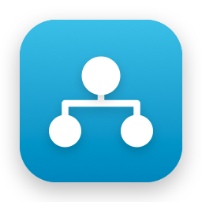

# SambaLite for Mac



SambaLite for macOS: a native Mac app (Swift, SwiftUI, AppKit where SwiftUI
on macOS 12 falls short) for SMB shares. Same product as the Android app,
no shared code. It talks to SMB 2/3 servers directly, without mounting:
browse, download, upload, and keep folders in sync. There is no account,
no cloud and no telemetry.

- **Browser.** A Finder-like file list with sortable columns, multiple
  selection, double-click to open, ⌘↑, ⌘[ and ⌘], drag and drop in both
  directions, and a context menu.
- **Transfer queue.** Transfers survive a restart and resume at the byte
  where they stopped. They retry by themselves, wait for the network, and
  show speed and remaining time.
- **Folder sync.** Three directions, schedules from 15 minutes to 24 hours,
  and optional mirror mode with the Android app's safeguards. When a file
  changed on both sides, the other version is kept as a conflict copy.
  A monitor shows per sync whether it works and why not.
- **Background running.** A menu bar item keeps syncs running with the
  window closed. "Open at Login" is in the app menu (macOS 13+).
- **Connections.** Imports and exports the Android app's connection files
  (`docs/connection_file.md`). Passwords live in the keychain.

macOS 12 or later, Apple silicon and Intel.

## Build, test, run

Needs Xcode (the SwiftUI macros do not come with the Command Line Tools).

```sh
swift build                       # everything
swift test                        # unit tests, ~1 s, no server needed
SAMBALITE_SMB_TEST=1 swift test   # + integration tests against Samba (below)
SAMBALITE_SMB_TEST=1 SAMBALITE_SMB_STALL_TEST=1 swift test
                                  # + pauses the container mid-download (~30 s)
scripts/bundle.sh                 # release build -> build/SambaLite.app
scripts/dmg.sh --universal        # arm64 + x86_64 -> build/SambaLite-<version>.dmg
scripts/icon.sh                   # redraw Packaging/AppIcon.icns from scripts/icon.swift
scripts/screenshot.sh out.png     # capture the window (Screen Recording + Accessibility)
swift run smb-probe               # poke the test server, for checking assumptions
```

The test server is a Samba container. Start it **without** a `-v` bind
mount: when Samba serves a folder shared from macOS into the Docker VM, it
refuses deletes (STATUS_NOT_SUPPORTED), which looks like an app bug but is
not.

```sh
docker run -d --name sambalite-mac-test -p 4452:445 \
  -e USER=smbuser -e PASS=secret123 -e NAME=Data dockurr/samba:4.23.8
```

For click-through checks, run the app with its own data folder and keep
passwords out of the keychain. A rebuilt binary is ad-hoc signed with a new
hash, so the keychain would ask every time.

```sh
open -n --env SAMBALITE_DATA=/tmp/sl-data --env SAMBALITE_PASSWORDS=file build/SambaLite.app
```

`SAMBALITE_PASSWORDS=file` keeps passwords in plain text in
`test-passwords.json` in that folder; `memory` forgets them on quit. The
real app uses `~/Library/Application Support/SambaLite` and the keychain.

## Layout

```
Sources/SambaLiteCore/   UI-free, everything with I/O behind a protocol
  RemoteFileSystem       protocol; SMBFileSystem (AMSMB2), DirectoryFileSystem (tests)
  FileCopier             one file up or down: part file, resume, checks, atomic rename
  TransferQueue          persistent queue (actor), Transfer, RateTracker
  SyncPlanner            pure decisions from both listings and the baseline
  SyncEngine             carries a plan out, keeps the baseline, writes the run log
  SyncCoordinator        configs, schedule, history, logs (actor); SyncNotice
  SyncModel              SyncConfig, SyncEntry/SyncState, SyncRunResult, SyncHealth
  Connection(File)       model, URL, paste cleanup; Android connection-file format
  Storage                AppFolder, JSONFile (atomic), keychain / memory / file stores
  Names, Failure         name rules (NFC, ignored, invalid, part names); error categories
Sources/SambaLite/       the app: AppModel (the only UI state), BrowserModel,
                         FileTable (NSTableView), views, editors, menu bar item
Sources/smb-probe/       developer tool
Tests/SambaLiteCoreTests Swift Testing; SMB suites opt in by environment
Vendor/AMSMB2/           AMSMB2 4.0.3 + libsmb2, patched (see its README-SambaLite.md)
```

## How robust it is, and why

The Android app was the floor. Places where this one goes further are
marked "(beyond Android)".

**One file (`FileCopier`)**

- The data goes into `<name>.<fingerprint>.sambalite-part` next to the
  target, and only a complete copy is renamed to the real name. A target
  file is therefore always one whole version. *(beyond Android: it wrote
  into the final name)*
- The fingerprint is a hash of the source's size and time. An interrupted
  copy resumes at the part file's length only when the source is still the
  same version. *(beyond Android: it restarted from 0 after a crash and
  never resumed downloads)*
- At the end the source is checked again. A file that changed while it was
  being copied fails with "changed during the transfer" and is synced on the
  next run, so it never arrives mixed. The part file's size must also equal
  the source's.
- Uploads swap in through `<name>.sambalite-old`, because SMB's rename does
  not replace. If the swap fails, the old file gets its name back.
  Downloads use rename(2), which replaces atomically.
- Modification times are carried over in both directions. A download
  checks free space first and again every 10 MB, keeping 10 MB in reserve
  as the Android app does.

**Queue (`TransferQueue`)**

- The queue is persisted in `transfers.json`, written atomically. After a
  crash, active transfers are pending again and resume.
- Two workers each keep one SMB session per connection.
- Transient errors are retried after 5 s, 15 s, 1 min and 5 min, up to 5
  attempts. Permanent errors (login, access, missing file) fail at once.
- Without network, attempts are not counted, and the queue goes on when
  the network comes back (NWPathMonitor).
- Downloads never replace a local file: a name taken since the transfer
  was queued gets a number (renamex_np with RENAME_EXCL). Uploads into a
  folder whose contents cannot be checked are refused instead of
  replacing unasked.
- Duplicates are refused. Cancel removes part files on both sides.
  Finished entries expire after 7 days.
- Idle sleep is held off while something runs. A stalled transfer shows
  as stalled after 10 s.

**Connections (`SMBFileSystem`)**

- Every request has a 30 s timeout. After a timeout or connection error
  the session is thrown away and the next call opens a fresh one. Calls
  that are safe to repeat are repeated once.
- libsmb2 reports a wrong password and a closed port alike (EPERM, no
  text), so a failed connect is followed by a TCP probe. That way the
  message says "login rejected" or "not reachable" correctly.
- AMSMB2's recursive delete lost files with umlauts, so `remove` recurses
  itself.
- The patch in `Vendor/AMSMB2`: a timed-out request kept a callback
  pointing at a dead stack frame. When the server came back (a NAS waking
  up), the late reply crashed the app. Found by pausing the server during
  a 1 GB download. The stall test reproduces it.

**Sync (`SyncPlanner`, `SyncEngine`)**

- **Change detection.** Size and time are compared with a 3 s tolerance,
  plus a baseline per file of both sides after the last successful step.
  "Changed here", "changed there" and "deleted" are therefore told apart.
- **One way.** A changed source wins over an unchanged target even when it
  is older (a restored backup). Otherwise the newer side wins.
- **Both ways.** The changed side wins. When both changed, or on a first
  run when the two differ, the newer wins and the other version is kept as
  `name (conflict <date>).ext` on its own side. *(beyond Android: it lost
  the older version)*
- **Targets edited during a run.** A file edited on the target side while
  a run is going (the plan is made at its start) is never replaced. The
  target is checked again just before the rename; the file waits for the
  next run, which sees the conflict. *(beyond Android)*
- **Deletions.** Never carried over, except by mirror mode, which works one
  way only. Mirror touches only baseline entries that are unchanged on the
  target. It is skipped when the source listing is incomplete or empty
  while the baseline is not. It is aborted when it would remove more than
  100 entries and more than half of the tracked ones.
- **Mirror targets.** Removed files go to the share's `.sambalite-trash/<ms>/`
  or to the Mac's Trash. Folders go only when they hold nothing the sync
  did not copy itself.
- **Unreadable folders.** A folder that cannot be listed on one side is
  left alone on the other. *(beyond Android: an unlistable remote folder
  counted as empty and everything was uploaded again)*
- **Missing local folder.** The run fails without touching anything, for
  example when the disk is not connected.
- **Names.** Umlauts are matched in NFC, so a decomposed name from the Mac
  and a composed one on the share are one file. Names that differ only in
  case are reported on a case-insensitive disk, not overwritten. Names SMB
  cannot store are reported, not mangled.
- **Ignored files.** `.DS_Store`, `._*` AppleDouble files, the volume
  folders, part files and the trash are never synced. *(Mac-specific)*
  Symbolic links are not followed.
- **Changed folders.** Changing a sync's folder empties its baseline. A
  run still finishing under the old folder cannot write it back (a
  generation counter), so mirror never deletes by a stale baseline.
- **Case twins.** When the share holds `Report.pdf` and `report.pdf` and
  this Mac's disk cannot, neither is matched to a local file; all are
  reported.
- **Interrupted runs.** The baseline is saved every 50 steps. A lost
  connection ends the run as failed, and everything it finished stays done.
- **Schedule.** One run per sync at a time, two syncs at most. A run that
  failed because the server was away is retried after 2, 4, 8 … minutes,
  never later than the interval. Wake from sleep and the network coming
  back trigger due runs. A sync can wait out a personal hotspot, which is
  the Mac's "WiFi only".
- **Monitor.** Health per sync: up to date, with errors, failed, overdue
  (twice the interval plus an hour), local folder missing, paused. Each
  sync keeps its last 20 runs as dots, errors grouped by cause with advice
  and "for n runs" streaks, and a searchable log of the last run. Copy
  Diagnostics produces a report. Notifications are sent only when the
  state changes.

## Known limits

- **Signing.** The app is ad-hoc signed and no Developer ID is configured.
  A downloaded copy has to be opened once with right-click > Open. After
  each update the keychain asks once for the stored passwords.
- **Throughput.** libsmb2 handles one request at a time per session. On
  localhost with SMB3 encryption that came to about 57 MB/s for a 1 GB file.
  A fast NAS on gigabit Ethernet may not reach line speed. Parallel reads
  per file would be the next step.
- **Colons in names.** A file whose name contains `:` (shown as `/` in
  Finder) is reported as an invalid name and not mapped to SFM characters
  the way macOS's own SMB client does.
- **Not in this version.** Server discovery (mDNS, subnet scan) and search
  across a share.

## Third-party code

`Vendor/AMSMB2` is AMSMB2 by Amir Abbas Mousavian and libsmb2 by Ronnie
Sahlberg, both LGPL-2.1-or-later. It is linked dynamically, ships as
`Contents/Frameworks/libAMSMB2.dylib` and can be replaced. Its source,
including the patch, is in this repository.
